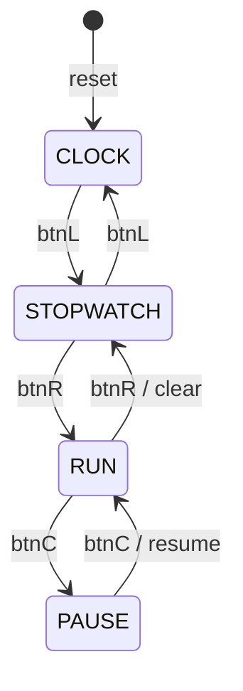
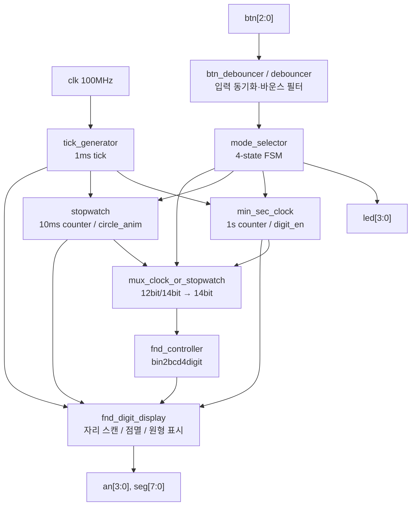

# MINSEC CLOCK & STOPWATCH — FPGA

> **Basys3 FPGA에서 동작하는 1초 단위 분·초 시계와 10ms 단위 스톱워치**  
> Verilog HDL로 FSM, 카운터, 버튼 디바운싱, MUX, FND 구동부를 모듈화하고 기능·경계 조건을 테스트벤치로 검증한 프로젝트

  

## Contents
1. [프로젝트 내용](#1-프로젝트-내용)
2. [코드 설명 및 아키텍처](#2-코드-설명-및-아키텍처)
3. [Testbench 및 검증](#3-testbench-및-검증)
4. [Trouble Shooting & 느낀 점](#4-trouble-shooting--느낀-점)
5. [요소기술](#5-요소기술)
6. [실행 방법과 개선 계획](#6-실행-방법과-개선-계획)

---

## 1. 프로젝트 내용

### 1.1 목표와 개발 환경

- **목표:** 하나의 FPGA 보드에서 **분·초 시계(CLOCK)**와 **스톱워치(STOPWATCH)**를 전환하여 공통 4자리 7-segment(FND)에 표시
- **핵심 설계:** FSM 기반 상태 전이, 두 카운터 독립 구동, MUX 기반 표시 선택, 디바운싱, 1ms tick, 원형 애니메이션
- **사용 보드:** Digilent **Basys3 (Xilinx Artix-7)**
- **개발 환경:** **Verilog HDL / Vivado / 100MHz 시스템 클럭**
- **입출력:** BTN L·C·R, 상태 LED 4개, FND 4자리(`an[3:0]`, `seg[7:0]`)

| 동작 모드 | 표시 및 기능 |
| --- | --- |
| CLOCK | 00:00~59:59, **1초마다 증가**. 다른 모드에서도 내부 시계는 계속 계수 |
| STOPWATCH (IDLE) | `0000` 표시, 계수 대기 |
| RUN | 10ms 단위 계수, 네 자리 0000~9999 (표시 기준 00.00~99.99초) |
| PAUSE | 수치 고정. 5초 대기 후 200ms 간격의 12단계 circle animation |

### 1.2 버튼 제어와 FSM

| 현재 상태 | 버튼 | 다음 상태 | 동작 |
| --- | --- | --- | --- |
| CLOCK | L | STOPWATCH | 대기 상태로 이동 |
| STOPWATCH | L | CLOCK | 분·초 시계 복귀 |
| STOPWATCH | R | RUN | 계수 시작 |
| RUN | R | STOPWATCH | 초기화 후 대기 |
| RUN | C | PAUSE | 카운트 유지 |
| PAUSE | C | RUN | 중단한 값부터 재개, 애니메이션 종료 |

- FSM state: `CLOCK=2'b00`, `STOPWATCH=2'b01`, `RUN=2'b10`, `PAUSE=2'b11`.
- `mode_selector`는 디바운싱된 버튼의 **falling edge(버튼을 놓을 때)**로 전환합니다.
- 상태 LED는 `4'b0001 << sel`로 4개 상태를 구분합니다.



## 2. 코드 설명 및 아키텍처

### 2.1 전체 블록 구조



**설계 의도:** 시간 **계수**와 FND **표시 데이터 선택**을 분리했습니다. 스톱워치 모드여도 시계가 멈추지 않으며, 12bit CLOCK / 14bit STOPWATCH 데이터를 공통 **14bit MUX**로 선택한 뒤 하나의 숫자 변환·표시부를 재사용합니다. 두 입력의 전체 비트 수 26bit는 **Fan-out 수치가 아닙니다.**

### 2.2 주요 Verilog 모듈

| 모듈 | 구현 내용 / 핵심 코드 |
| --- | --- |
| `top_clock_stopwatch.v` | 전체 모듈 인스턴스 연결. `w_tick`, `w_sel`, `w_circle_anim`, `w_digit_en` 등 제어·데이터 신호 배선 |
| `btn_debouncer.v` / `debouncer.v` | 버튼 3개 각각에 디바운서 적용, 안정된 버튼 신호를 FSM에 전달 |
| `mode_selector.v` | current/next-state 및 falling-edge 기반 상태 전이. `next_state = sel` 기본값으로 불필요한 latch 방지 |
| `tick_generator.v` | 100MHz → 1ms 단일 사이클 tick enable 생성 (`100_000`회 분주) |
| `min_sec_clock.v` | 1ms tick 1,000개로 1초 생성, 3,600초 단위 순환; `sel`과 무관하게 계수 |
| `stopwatch.v` | 10tick = 10ms마다 카운트; PAUSE에서 5,000tick 경과 시 `circle_anim` 활성화 |
| `mux_clock_or_stopwatch.v` | 모드에 따라 12bit 시계 값 zero extension 또는 14bit 스톱워치 값을 선택 |
| `fnd_controller.v` | `bin2bcd4digit`와 `fnd_digit_display` 연결 |
| `bin2bcd4digit` | CLOCK 값(초)을 MM:SS 자릿수로, 스톱워치 계수를 네 자리 십진 숫자로 변환 |
| `fnd_digit_display` | 1ms 자리 스캔, CLOCK 구분점 점멸, 200ms×12-step circle animation, active-low FND 출력 |

#### 코드 포인트 A — 버튼 이벤트를 이용한 FSM 전이

```verilog
assign btnL_valid = prev_btnL && ~btn[0];
assign btnC_valid = prev_btnC && ~btn[1];
assign btnR_valid = prev_btnR && ~btn[2];

always @(*) begin
    next_state = sel;
    case (sel)
        CLOCK:     if (btnL_valid) next_state = STOPWATCH;
        STOPWATCH: if (btnL_valid) next_state = CLOCK;
                   else if (btnR_valid) next_state = RUN;
        RUN:       if (btnR_valid) next_state = STOPWATCH;
                   else if (btnC_valid) next_state = PAUSE;
        PAUSE:     if (btnC_valid) next_state = RUN;
        default: next_state = CLOCK;
    endcase
end
```

> `sel`은 조합회로가 만든 클럭이 아니라 **`posedge clk`에서 갱신되는 레지스터 상태 출력**입니다. 이를 MUX 등의 조합 선택 신호로 사용합니다.

#### 코드 포인트 B — stopwatch의 계수와 PAUSE 타이머

```verilog
else if (sel == RUN) begin
    circle_anim <= 0;
    r_5sec_counter <= 0;
    if (tick) begin
        if (r_1ms_counter >= 9) begin
            r_1ms_counter <= 0;
            if (r_10ms_counter >= 9999)
                r_10ms_counter <= 0;
            else
                r_10ms_counter <= r_10ms_counter + 1;
        end else r_1ms_counter <= r_1ms_counter + 1;
    end
end
else if (sel == PAUSE) begin
    if (tick) begin
        if (r_5sec_counter >= 4999) begin
            r_5sec_counter <= 0;
            circle_anim <= 1;
        end else
            r_5sec_counter <= r_5sec_counter + 1;
    end
end
```

- 10ms 카운터를 1ms tick 10개마다 증가시킵니다.
- PAUSE에 들어가면 계수값을 유지하고, **5,000번째 tick**에 애니메이션을 시작합니다.
- RUN으로 돌아올 때 5초 카운터·애니메이션을 초기화합니다.

#### 코드 포인트 C — MUX와 BCD 변환

```verilog
// 개념: CLOCK은 12bit이므로 상위 2bit zero extension
assign seg_data = (sel > 0)
    ? seg_data_stopwatch
    : {{2{1'b0}}, seg_data_clock};

// 모드별로 분/초 또는 일반 4자리 10진수로 변환
assign d1    = seg_data % 10;
assign d10   = (sel) ? (seg_data / 10) % 10 : (seg_data / 10) % 6;
assign d100  = (sel) ? (seg_data / 100) % 10 : (seg_data / 60) % 10;
assign d1000 = (sel) ? (seg_data / 1000) % 10 : (seg_data / 600);
```

> 위 MUX 구문은 **비트 폭 확장을 설명하는 개념 발췌**입니다. 실제 파라미터화된 구현은 `mux_clock_or_stopwatch.v`를 확인하세요.

### 2.3 실제 저장소 구조

```text
my_min_sec_clock_stopwatch.xpr
my_min_sec_clock_stopwatch.srcs/
├── constrs_1/imports/digilent-xdc-master/
│   └── Basys3-Master_orginal.xdc
├── sources_1/
│   ├── new/
│   │   ├── top_clock_stopwatch.v
│   │   ├── mode_selector.v
│   │   ├── min_sec_clock.v
│   │   ├── stopwatch.v
│   │   └── mux_clock_or_stopwatch.v
│   └── imports/
│       ├── new/
│       │   ├── tick_generator.v
│       │   └── fnd_controller.v  # bin2bcd4digit, fnd_digit_display 포함
│       └── sources_1/
│           ├── imports/new/btn_debouncer.v
│           └── new/debouncer.v
└── sim_1/new/
    ├── tb_top_clock_stopwatch.v
    ├── run_requirements.tcl
    └── README_testbench.md
```

## 3. Testbench 및 검증

### 자동 판정 구조

**버튼 입력 생성(`press_button`) → DUT(`top_clock_stopwatch`) → `sel`/LED/FND 검사 → 독립 참조 모델과 비교**

- 100MHz 입력 클럭은 유지하고, 시뮬레이션에서 분주 상수를 **100,000 → 20 clocks**, debounce limit를 **3**으로 축소해 기능 시간을 가속합니다.
- 1tick의 **기능적 의미는 1ms**, 실제 시뮬레이션 파형상으로는 **200ns**입니다.
- 매 검사에서 FND 자리 선택 `an`과 세그먼트 `seg`, LED, 상태, X 값을 비교하고, 제한시간 watchdog을 둡니다.
- 중점 경계: **00:59 → 01:00**, PAUSE **4,999tick/5,000tick**, **200tick × 12단계** animation, RUN 복귀 후 재계수 및 CLOCK 재진입.

| 비교 대상 | 실제 동작 기준 | 가속 시뮬레이션 시간 |
| --- | --- | --- |
| 시스템 클럭 | 10ns | 10ns |
| 1ms tick | 100,000 clocks | 20 clocks = 200ns |
| 스톱워치 10ms | 10 ticks | 2μs |
| CLOCK 1s | 1,000 ticks | 200μs |
| PAUSE 5s | 5,000 ticks | 1ms |

**발표 자료 18페이지에 첨부된 결과:** `7,256,097 checks / 71,470 functional ms`에 대한 **PASS 로그**. 이는 발표 자료에 포함된 검증 기록이며, 모든 하드웨어 타이밍 경로의 STA 통과를 의미하지는 않습니다.

테스트 상세: [README_testbench.md](my_min_sec_clock_stopwatch.srcs/sim_1/new/README_testbench.md)

## 4. Trouble Shooting & 느낀 점

### 4.1 요구 스펙과 Block Diagram의 불일치

**문제:** 초기 블록도에는 (1) **PAUSE 5초 이후 Circle animation**, (2) **CLOCK 분·초 사이 점멸 표시**를 누락했습니다. RTL 구현 중 `r_5sec_counter`, `circle_anim`, `digit_en` 제어가 추가되며 `stopwatch`, `min_sec_clock`, 표시부의 입력·출력을 다시 연결해야 했습니다.

**느낀 점:** 구현 시작 전에 **요구 스펙 → FSM → Block Diagram/포트 → 테스트 시나리오**를 일관되게 맞추는 것이 수정 비용을 줄이는 핵심임을 배웠습니다.

### 4.2 조합 경로의 Glitch 및 Setup/Hold 위험

**검토한 구조:** `Counter / sel FF → MUX → bin2bcd4digit → FND 표시 경로`

- MUX와 BCD 변환은 **조합 경로**입니다. 입력 전이의 경로 지연 차이는 순간적인 glitch를 만들 수 있습니다.
- 실제 FF가 해당 경로를 캡처하는 경우, 긴 조합·배선 지연으로 **setup slack**이 감소할 수 있습니다. **조합회로 입력 자체에 setup time이 존재하는 것은 아닙니다.**
- **개선안:** 동일 클럭의 파이프라인/출력 레지스터를 도입하고 `sel`, `circle_anim`, `digit_en`을 동일 지연 단계로 정렬; 추가 latency를 검증 모델에 반영합니다.
- **검증 상태:** 이는 **위험 분석 및 개선안**으로서, 현재 설계에서 실제 glitch나 setup/hold 위반을 측정했다는 뜻은 아닙니다.

### 4.3 `sel` Fan-out 검토 누락

**문제:** 초기 설계 시 `sel[1:0]`을 여러 모듈로 보내는 **논리적 연결만** 고려했고, 실제 net의 sink 수와 배선 범위를 조사하지 않았습니다.

**가능한 영향:** 다수 sink, 넓은 배선 → route delay·부하 증가 → timing margin 감소 가능. **모듈 개수나 데이터 버스 비트 수가 곧 fan-out인 것은 아닙니다.**

**개선안:** `report_high_fanout_nets`, `report_timing_summary`로 `sel` 각 bit, `tick`, `reset`의 sink 및 net delay 확인. 문제가 확인된 경우에만 로컬 제어 신호화·register 복제 검토.

**교훈:** RTL의 기능 연결뿐 아니라 **합성·배치·배선 결과로 물리적인 신호 전달 비용을 검증**해야 합니다.

### 4.4 구현 후기

- **계수와 표시 선택을 분리**해 스톱워치 사용 중에도 시계를 계속 진행시켰습니다.
- 상태 전이 확인을 넘어 **4자리 FND 스캔, PAUSE 경계 시간, 애니메이션을 자동 판정**하도록 테스트를 확장했습니다.
- 다음 단계에서는 실제 디바운스·CDC, 카운터 전체 순환, 포스트-라우트 timing을 재확인할 계획입니다.

## 5. 요소기술

이 절은 프로젝트에서 **적용한 구조**와 PPT에서 **학습·추가 검토한 이론**을 구분합니다.

| 요소기술 | 핵심 개념 | 프로젝트에서의 적용 / 검토 |
| --- | --- | --- |
| FSM | 현재 상태, 다음 상태, 전이 조건 | 4개 동작 상태와 버튼 이벤트, 상태 LED 구현 |
| Counter / Clock Enable | 기준 클럭 유지 + tick 기반 계수 | 100MHz → 1ms tick; 1초 및 10ms 계수 |
| Debounce / Edge | 비동기 버튼, 채터링 및 이벤트 단발성 | 디바운싱된 버튼 falling-edge로 상태 전환 |
| MUX / BCD / FND | 데이터 선택, 10진 자릿수 변환, 시분할 표시 | 12/14bit 선택 후 공통 4자리 표시 |
| **Setup / Hold** | FF 캡처 에지 전후 안정 시간 | **STA 및 파이프라인 개선 검토 대상** |
| **Metastability / CDC** | 비동기 입력의 샘플링 불안정 | 버튼 동기화 단계, `ASYNC_REG`, reset 해제 시점 점검 대상 |
| **Glitch** | 조합 경로 지연 차이로 인한 순간 펄스 | MUX/BCD/FND 데이터 경로와 신호 등록의 필요성 분석 |
| **Fan-out** | 단일 net이 구동하는 sink 수 | `sel`, `tick`, `reset`의 실제 load / route delay 분석 계획 |

### 5.1 Setup / Hold Timing

- **Setup:** 캡처 에지 **직전** 데이터 안정 시간.
- **Hold:** 캡처 에지 **직후** 데이터 안정 시간.
- 동일 클럭, clock skew·uncertainty 0으로 단순화하면:

```text
Setup: Tclk >= tCQ,max + tPD,max + tsetup
Hold : tCQ,min + tPD,min >= thold
```

긴 데이터 경로에는 논리 축소·파이프라인·주기 확대 등을, 짧은 hold 경로에는 배선·skew·지연 조정 등을 고려합니다. **클럭 주기를 늘리는 것만으로 일반적인 동일 에지 hold 문제는 해결되지 않습니다.**

### 5.2 Metastability / CDC

비동기 버튼이 플립플롭의 샘플링 에지 부근에서 변하면 metastability가 발생할 수 있습니다. 일반적인 **레벨 입력**에는 2단 이상 동기화 FF와 `ASYNC_REG` 속성을 활용합니다.

```text
Asynchronous BTN -> FF1 -> FF2 -> Debounce -> Edge Detect -> FSM
```

2FF는 실패 확률을 줄일 뿐 **0으로 보장하지 않습니다**. **동기화는 metastability 전파 완화, debounce는 바운스 제거**이므로 역할이 다릅니다. 펄스·멀티비트 버스·비동기 reset에는 별도의 CDC 패턴 및 해제 순서 검토가 필요합니다.

### 5.3 Glitch

재결합 조합 논리 `Y=(A&B)|(~A&C)`에서 경로 지연이 달라지면, 논리적으로 Y=1이어야 해도 순간적인 low pulse가 발생할 수 있습니다. 중요한 제어 신호에는 **clock enable**, 결과 안정화를 위해 **출력 레지스터**를 고려합니다. 표시 전환 시 잔상에는 `digit OFF → segment 갱신 → 다음 digit ON`의 blank 구간 설계가 유효할 수 있습니다.

### 5.4 Fan-out

한 net의 부하 입력 핀 개수가 증가하면 배선 범위·route delay가 늘어날 수 있습니다. 이 프로젝트의 **CLOCK 12bit + STOPWATCH 14bit → MUX 출력 14bit**는 **버스 데이터 폭 최적화/표시 경로 공유**에 대한 설명이지, fan-out 최적화 실측 결과는 아닙니다.

### 5.5 Vivado Timing / CDC 확인 명령

```tcl
report_timing_summary
report_timing -delay_type max -max_paths 10
report_timing -delay_type min -max_paths 10
report_high_fanout_nets
report_cdc -details
report_clock_interaction
report_exceptions
```

배치·배선 후 **WNS/TNS, WHS/THS, critical path, net delay, clock skew**, 미제약 경로를 확인할 계획입니다. 이는 수행을 권장하는 명령으로서 **측정 결과를 주장하는 내용은 아닙니다.**

> **확장 학습:** 발표 자료에서는 위 요소기술이 임베디드 SPI 샘플링 타이밍, Linux GPIO/IRQ, SSD/NAND PHY timing, DMA/MMIO 순서 제어와 어떤 관계가 있는지도 비교했습니다. 이 부분은 본 FPGA 프로젝트의 직접 구현 범위가 아닌 **직무 연계 학습**입니다.

## 6. 실행 방법과 개선 계획

### 6.1 시뮬레이션 실행

```bash
git clone https://github.com/kobokdong/MINSEC_CLOCK_N_STOPWATCH-FPGA-.git
```

1. Vivado에서 `my_min_sec_clock_stopwatch.xpr` 열기
2. Design Top: `top_clock_stopwatch`
3. Simulation Top: `tb_top_clock_stopwatch`
4. **Run Behavioral Simulation → Run All** (기본 1,000ns 실행만으로는 부족)

프로젝트 루트에서 Vivado Tcl Console을 이용할 경우:

```tcl
source ./my_min_sec_clock_stopwatch.srcs/sim_1/new/run_requirements.tcl
```

### 6.2 향후 검증·개선 과제

- 시계 59:59 → 00:00, 스톱워치 9999 → 0000 등 전체 순환 검증
- 실제 버튼 바운스와 긴 누름·연속 입력 테스트
- CDC 구조 및 `ASYNC_REG`, reset 해제 타이밍, 실제 XDC 제약 점검
- 배치·배선 후 STA와 `sel`/tick/reset fan-out 실측
- 실보드 동작 동영상, 파형, 검증 로그를 별도 증빙 자료로 정리

**참고 자료:** 프로젝트 발표 자료 *minsec_Clock_n_Stopwatch(w.FPGA)* (프로젝트·코드 p.2~19, Troubleshooting p.20~24, 요소기술 p.25~45) 및 저장소 내 RTL / 테스트벤치.

---

**Author:** [kobokdong](https://github.com/kobokdong)  
**Repository:** [MINSEC_CLOCK_N_STOPWATCH-FPGA-](https://github.com/kobokdong/MINSEC_CLOCK_N_STOPWATCH-FPGA-)
